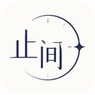
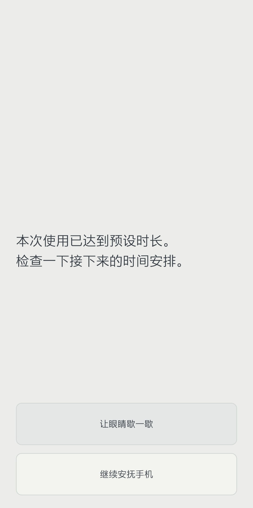
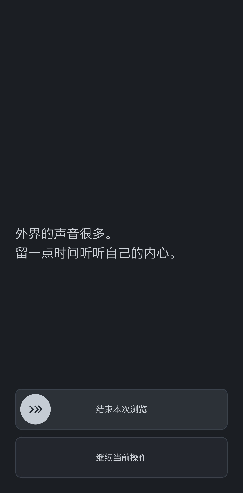

<p align="center">
  
</p>

<h1 align="center">止间 · Zhijian</h1>

<p align="center">
  <b>少一点无意识的打开，多一点自己的时间。</b>
</p>

<p align="center">
  面向 Android 的应用使用管理工具。让陶醉在使用手机的你有一个提醒伙伴。<br/>
</p>

<p align="center">
  <a href="https://github.com/vhoom/zhijian/releases"></a>
  <a href="#install"></a>
  <a href="#build"></a>
  <a href="LICENSE"></a>
</p>

<p align="center">
  <a href="#preview">效果预览</a> ·
  <a href="#install">安装使用</a> ·
  <a href="#privacy">隐私与权限</a> ·
  <a href="#build">源码构建</a> ·
  <a href="#docs">项目文档</a> ·
  <a href="#contributing">参与贡献</a>
</p>

---

## 主要功能

### 看清使用情况

- 查看当天应用使用时长、用量榜单和按日期归档的历史记录。

### 为应用设置边界

单个应用可以单独配置，也可以加入规则组共享额度；支持按星期设置不同参数。

| 规则 | 作用               |
| --- |------------------|
| 全天限时、时段限时 | 限制一天或指定时段内的累计使用时长。 |
| 全天限次、时段限次 | 限制一天或指定时段内的真实打开次数。 |
| 频率限次 | 限制连续时间窗口内的打开次数。  |
| 全天连续提醒、时段连续提醒 | 连续使用达到阈值后触发防沉迷。  |
| 时段禁用 | 在指定时段触发触发防沉迷。         |


### 给继续使用增加一次选择

- **按压挑战**：保持按压，完成意识的救赎。
- **单词挑战**：通过词义选择，在继续前短暂停留。
- **数独挑战**：完成一局 9×9 数独，支持简单、中级、困难三档难度。

## 三种管控强度

| 档位 | 触发后的行为                          |
| --- |---------------------------------|
| **无为** | 温和提醒，保留主动选择继续使用的入口。             |
| **修心** | 可加入挑战和再次确认，为继续使用增加缓冲。           |
| **闭关** | 按规则等待限制解除或完成休息，不提供挑战放行并具有对抗性操作。 |


具体设置和恢复边界见[界面与配置说明](https://github.com/vhoom/zhijian/blob/main/docs/界面与配置说明.md)。


<a id="preview"></a>

## 效果预览

| 浅色主题 | 深色主题 |
| :---: | :---: |
| <a href="public/preview1.jpg"></a> | <a href="public/preview2.jpg"></a> |
<a id="install"></a>
## 安装使用

支持 **Android 10 及以上**。前往[版本发布页](https://github.com/vhoom/zhijian/releases)查看可下载的 APK；也可以[从源码构建](#build)。

选择适合设备的一份安装包即可：

| 设备 | APK 架构后缀 |
| --- | --- |
| ARM 64 位设备，多数较新的 Android 手机 | `arm64-v8a.apk` |
| ARM 32 位设备 | `armeabi-v7a.apk` |
| 不确定架构时 | `universal.apk` |

**首次使用：**

1. 安装并打开止间，按首页引导开启使用情况访问和无障碍服务。
2. 根据设备提供的选项检查电池优化、自启动和后台运行设置；部分系统还需要允许后台弹出界面。
3. 在管控中心选择应用，或建立规则组，设置并启用所需规则。
4. 选择管控强度；使用修心时，可在设置中调整挑战和再次确认选项。

不同厂商的系统设置入口有所区别，以应用内引导和设备实际选项为准。

<a id="privacy"></a>

## 隐私与权限

- **使用情况访问**：用于读取应用使用记录，生成统计和规则判定所需的用量。
- **无障碍服务**：用于响应前台应用切换和执行拦截；只订阅窗口切换事件，不请求读取窗口内容。
- **本地保存**：规则、统计与挑战进度保存在设备上，应用未声明联网权限。
- **系统备份**：Android 系统备份和设备迁移仍受系统设置控制。

需要排查问题时，可在应用内查看或导出本地诊断。采集范围见[本地诊断说明](https://github.com/vhoom/zhijian/blob/main/docs/本地诊断说明.md)。

<a id="build"></a>

## 从源码构建

准备支持当前 Android Gradle 插件的 Android Studio、**JDK 17** 和 **Android SDK 36**。

```sh
git clone https://github.com/vhoom/zhijian.git
cd zhijian
```

在 Android Studio 中打开项目并同步 Gradle，然后在项目根目录构建 Debug APK。

**Windows / PowerShell：**

```powershell
.\gradlew.bat :app:assembleDebug
```

**Linux / macOS：**

```sh
./gradlew :app:assembleDebug
```

输出位于 `app/build/outputs/apk/debug/`，文件名为 `止间_<版本号>_debug_<架构>.apk`。完整构建会生成 ARM 64 位、ARM 32 位和通用三份输出。

Debug 包使用调试签名。Release 已启用代码混淆与资源压缩，正式分发前需要配置发布签名。

构建配置以 [app/build.gradle](https://github.com/vhoom/zhijian/blob/main/app/build.gradle) 为准，依赖版本见 [gradle/libs.versions.toml](https://github.com/vhoom/zhijian/blob/main/gradle/libs.versions.toml)。签名、构建和产物核对步骤见 [APK 构建说明](https://github.com/vhoom/zhijian/blob/main/docs/APK构建说明.md)。

<a id="docs"></a>

## 项目文档

| 文档 | 内容 |
| --- | --- |
| [界面与配置说明](https://github.com/vhoom/zhijian/blob/main/docs/界面与配置说明.md) | 页面、规则、权限引导与设置。 |
| [规则计时起点](https://github.com/vhoom/zhijian/blob/main/docs/architecture/规则计时起点.md) | 首次启用、重装恢复、强度切换与用量边界。 |
| [挑战进度与重新进入](https://github.com/vhoom/zhijian/blob/main/docs/architecture/挑战进度与重新进入.md) | 单词和数独的刷新、保存与恢复。 |
| [架构索引](https://github.com/vhoom/zhijian/blob/main/docs/architecture/README.md) | 项目结构、模块职责与依赖关系。 |
| [UI 设计规范](https://github.com/vhoom/zhijian/blob/main/docs/UI设计规范.md) | 字号、间距、颜色、组件与动效。 |
| [测试目录与运行说明](https://github.com/vhoom/zhijian/blob/main/docs/testing/README.md) | 用例分类、运行条件与实际验证范围。 |
| [本地诊断说明](https://github.com/vhoom/zhijian/blob/main/docs/本地诊断说明.md) | 日志采集、导出与问题定位。 |

<details>
<summary>源码结构</summary>

项目使用 Java 与 XML 原生视图，只有一个 Android 构建模块 `:app`。应用 ID 为 `github.vhoom.zhijian`，持久化使用 Room / SQLite、SharedPreferences 和本地文件。

```text
app/src/main/java/github/vhoom/zhijian/
├── ui/             页面、设置、组件和拦截交互
├── domain/         规则判断、使用量计算和挑战逻辑
├── runtime/        拦截执行与运行协调
├── accessibility/  无障碍服务和前台应用观察
├── data/           模型、数据库、系统数据源与存储
└── util/           跨模块共用工具
```

布局与主题位于 `app/src/main/res/`，词库等文本资源位于 `app/src/main/assets/`，Room 结构描述位于 `app/schemas/`。测试分别位于 `app/src/test/` 和 `app/src/androidTest/`；README 展示资源位于 `public/`。

</details>

<a id="contributing"></a>

## 参与贡献

- **反馈问题**：在 [Issues](https://github.com/vhoom/zhijian/issues) 中提供设备型号、Android 版本、复现步骤，以及预期和实际行为。
- **提出建议**：说明具体使用场景、遇到的困难和希望改进的地方。
- **改进代码与文档**：可从文档、规则边界、设备适配或测试入手，提交 [Pull Request](https://github.com/vhoom/zhijian/pulls)。

参与开发前请阅读[项目协作约定](https://github.com/vhoom/zhijian/blob/main/AGENTS.md)和[测试说明](https://github.com/vhoom/zhijian/blob/main/docs/testing/README.md)。提交说明应注明实际验证范围，界面改动附截图。

## 许可证

项目采用 **GNU GPL v2**，详见 [LICENSE](LICENSE)。
