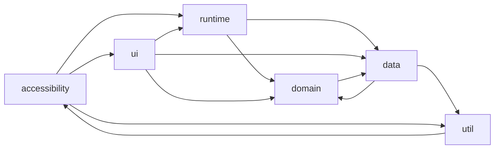
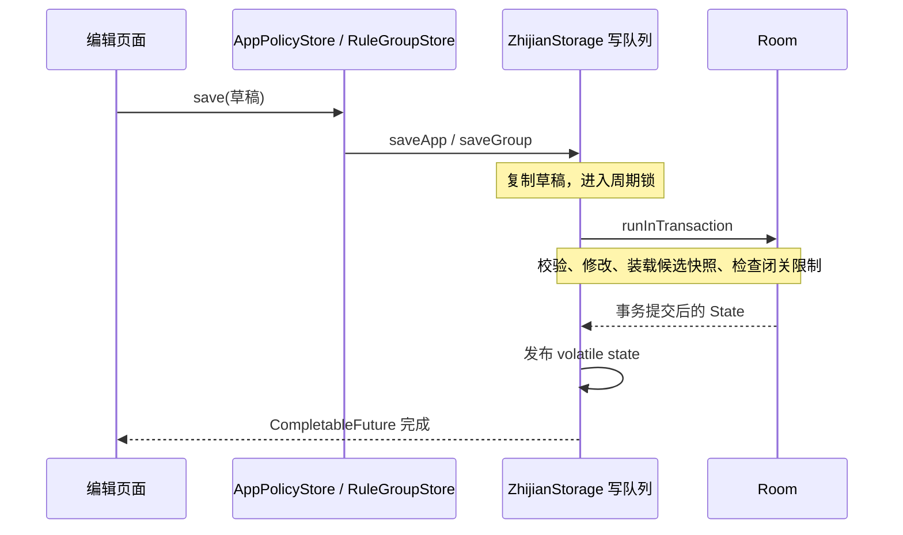
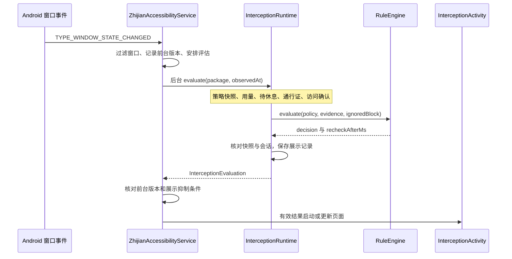

# 模块依赖与关键调用链

本文区分构建依赖、Java 包引用和运行时调用。代码基线、扫描范围和限制见[索引](README.md)；目录职责见[项目结构](项目结构.md)。

数独新增的页面、纯 Java 棋盘与进度文件依赖关系见[数独挑战与进度](数独挑战与进度.md)。该扩展复用页面注册和状态机，未新增 Gradle 模块或 Room 表；下方统计矩阵仍对应索引注明的扫描基线。

## 构建依赖

[settings.gradle](../../settings.gradle) 只包含 `:app`，不存在模块间的 `implementation project(...)` 依赖。实际直接依赖以 [app/build.gradle](../../app/build.gradle) 为准，版本来自 [libs.versions.toml](../../gradle/libs.versions.toml)。

| 配置 | 依赖 | 当前版本 / 作用 |
|---|---|---|
| 应用插件 | `com.android.application` | 9.2.1 |
| `implementation` | `androidx.room:room-runtime` | 2.8.4，正式运行时存储 |
| `annotationProcessor` | `androidx.room:room-compiler` | 2.8.4，Java 注解处理与 schema 导出 |
| `testImplementation` | `junit:junit` | 4.13.2，本地测试 |
| `androidTestImplementation` | `androidx.test.ext:junit` | 1.3.0，设备测试 |
| `androidTestImplementation` | `androidx.test.espresso:espresso-core` | 3.7.0，设备 UI 测试 |

版本目录中还有 Compose、Kotlin 等条目，但 `app` 没有应用 Compose 插件或声明这些库为依赖。目录中“存在版本”不等于应用“实际使用”。表中未枚举依赖传递带入的库，也未运行 Gradle 解析依赖树。

## 顶层包引用矩阵

行是引用方，列是被引用方；`bootstrap` 仅代表根包中的 `ZhijianApplication`。数值为正式源码中的显式内部 import 声明数，主对角线不统计。

| 来源 ↓ / 目标 → | bootstrap | accessibility | runtime | ui | domain | data | util |
|---|---:|---:|---:|---:|---:|---:|---:|
| bootstrap | — | 0 | 3 | 1 | 0 | 3 | 2 |
| accessibility | 1 | — | 1 | 1 | 3 | 5 | 3 |
| runtime | 0 | 0 | — | 0 | 9 | 19 | 5 |
| ui | 1 | 1 | 1 | — | 19 | 130 | 46 |
| domain | 0 | 0 | 0 | 0 | — | 44 | 0 |
| data | 0 | 0 | 0 | 0 | 41 | — | 20 |
| util | 0 | 4 | 0 | 0 | 0 | 0 | — |

复核口径：遍历 `main` 的 Java 文件，以包声明和文件名建立顶层类型集合；解析 `import` / `import static`，内部类或静态成员归到所属顶层类型，再按来源和目标顶层包汇总。多个文件引用同一个类型分别计数；生成类型、第三方类型、同包引用和全限定写法不计入表格。

因此零值不表示完全没有依赖。例如 `InterceptionActivity` 通过全限定名称使用 `runtime.interception.InterceptionRuntime`，`ZhijianAccessibilityService` 也以全限定名称调用 `UsageArchiveCoordinator`。这些真实调用已纳入下文，但不混入 import 统计。

下面只画主链路及关键反向引用，箭头表示使用关系：



图中的 `data ↔ domain`、`accessibility ↔ util` 是现状。`util` 内只有部分权限工具需要服务类型，不能把此图理解为每个工具类都参与循环。

## 关键边的源码证据

| 引用或调用 | 代码证据 | 依赖含义 |
|---|---|---|
| 启动 → 存储、运行任务、文案 | [ZhijianApplication.onCreate / checkRequiredResources](../../app/src/main/java/github/vhoom/zhijian/ZhijianApplication.java) | 应用根负责装配与就绪信号，也依赖 UI 包中的文案目录 |
| 无障碍 → 运行层 → 规则计算 | [ZhijianAccessibilityService.evaluateForeground](../../app/src/main/java/github/vhoom/zhijian/accessibility/ZhijianAccessibilityService.java)、[InterceptionRuntime.evaluate](../../app/src/main/java/github/vhoom/zhijian/runtime/interception/InterceptionRuntime.java) | 服务处理前台和调度，运行层组装评估上下文 |
| 系统读取 → 领域证据 | [UsageEvidenceReader.read](../../app/src/main/java/github/vhoom/zhijian/data/source/UsageEvidenceReader.java)、[UsageEventTimeline.read](../../app/src/main/java/github/vhoom/zhijian/data/source/UsageEventTimeline.java) | Android UsageEvents 被转换为时间轴和 `UsageEvidence` |
| 领域规则 → 配置模型 | [RuleEngine.evaluate](../../app/src/main/java/github/vhoom/zhijian/domain/interception/RuleEngine.java) | 使用 `RuleGroup`、`RuleWindow`、`ControlLevel`，不直接查询 Android 用量服务 |
| 存储 ↔ 领域包 | [ZhijianStorage.commitConfigurationOnWriter](../../app/src/main/java/github/vhoom/zhijian/data/store/ZhijianStorage.java)、[RetreatChangePolicy.requireAllowed](../../app/src/main/java/github/vhoom/zhijian/domain/interception/RetreatChangePolicy.java) | 存储调用闭关变更规则，该规则的参数又是 `data.store.PolicySnapshot` |
| 页面 → 流程与页面工厂 | [InterceptionActivity.dispatch / render](../../app/src/main/java/github/vhoom/zhijian/ui/interception/InterceptionActivity.java)、[InterceptionPageRegistry](../../app/src/main/java/github/vhoom/zhijian/ui/interception/page/InterceptionPageRegistry.java) | Activity 处理生命周期，状态机计算下一步，注册表构造对应 View 页面 |
| 页面结果 → 多个状态存储 | [InterceptionOutcomeWriter.save](../../app/src/main/java/github/vhoom/zhijian/ui/interception/session/InterceptionOutcomeWriter.java) | 根据效果写审计/通行证，再确认或清理会话 |
| 权限工具 ↔ 无障碍 | [PermissionStatusReader.read](../../app/src/main/java/github/vhoom/zhijian/util/permission/PermissionStatusReader.java)、[ZhijianAccessibilityService.onServiceConnected](../../app/src/main/java/github/vhoom/zhijian/accessibility/ZhijianAccessibilityService.java) | 权限检查需要具体服务身份与连接状态；服务又读取权限状态 |

## 启动与配置提交

`ZhijianApplication.onCreate()` 触发 `ZhijianStorage.get()`，存储在单写入队列中打开数据库、初始化默认规则、装载策略与运行快照以及词库。完成后发布 `State`，再完成 `ready()`。

应用还通过 `startupReady` 等待必需文案和挑战配置检查。`ZhijianApplication.ready()` 与 `ZhijianStorage.ready()` 的含义不同：前者还包括资源检查；[ThemedActivity.whenStorageReady](../../app/src/main/java/github/vhoom/zhijian/ui/activity/ThemedActivity.java) 实际等待应用级就绪，服务评估也等待该信号。

编辑配置的主路径如下。它描述配置写入，不代表所有设置都通过 Room。



[PolicySnapshot.effectiveFor / effectivePolicyId](../../app/src/main/java/github/vhoom/zhijian/data/store/PolicySnapshot.java) 的策略选择顺序为：已启用的单应用覆盖 → 首个适用的已启用且有规则的规则组 → 全局策略。`usageScopeFor` 用有效策略身份判断组内共享范围；编辑组成员或单应用覆盖会影响用量归属，不能只看应用是否出现在组列表中。

## 前台到拦截页面



具体边界：

- 服务的主线程 Handler 管调度，`zhijian-interception` 单线程执行器处理运行评估。前台版本变化会使旧计算结果失效；特定规则组场景有再次校验后的重定向处理。
- 运行层先处理遗留休息、已完成结果与通行证，再收集当前证据并调用规则引擎；禁用判定先于提醒展示。它不是只把一次 `RuleEngine.evaluate()` 的结果直接打开。
- `RuleEngine` 汇总时间窗口、额度与次数禁用，再处理连续提醒，返回建议复查间隔。次数规则交给 [CountRuleEvaluator](../../app/src/main/java/github/vhoom/zhijian/domain/interception/count/CountRuleEvaluator.java)。
- `InterceptionRuntime.present()` 在周期锁内校验策略快照，检查新的通行证或访问确认；服务在实际启动页面前还会再次检查，防止异步旧结果重新弹页。
- `InterceptionActivity.recheckForRecovery()` 会后台调用运行层，并使用请求代次与恢复代次过滤旧回调。服务启动不是页面的唯一规则复查入口。

## 页面交互与保存

[InterceptionFlow](../../app/src/main/java/github/vhoom/zhijian/domain/interception/InterceptionFlow.java) 输入阶段与事件，输出阶段与效果；[ModeFlowPlan](../../app/src/main/java/github/vhoom/zhijian/domain/interception/ModeFlowPlan.java) 按模式和本会话设置选择页面顺序。页面通过 `Consumer<InterceptionEvent>` 上报动作，不直接承担规则评估。

`InterceptionActivity.complete()` 显示保存态，调用结果写入器并等待异步完成；允许继续但保存失败时会恢复页面，不提前导航。其后续过程为：

```text
InterceptionOutcomeWriter.save
  → RuntimeStateStore.recordInterception
  → Room 事务写审计记录及可选通行证
  → 刷新 RuntimeSnapshot
  → 根据本会话效果确认提醒 / 确认当前访问禁用 / 清理展示
  → Activity 核对请求代次后继续导航
```

这里的 Room 事务和后续 SharedPreferences 写入是两个阶段，不能由上述顺序推断跨存储原子性。具体身份保护与恢复约束见[耦合分析](耦合分析.md)。

## 首页读取与归档支线

- [MainActivity](../../app/src/main/java/github/vhoom/zhijian/ui/activity/MainActivity.java) 使用 `UsageStatsReader` 获取当天证据，使用 `UsageArchiveStore` 获取归档，并交给 `DailyUsage` / `DashboardBinder` 形成展示数据。
- [CachedAppCatalog.load](../../app/src/main/java/github/vhoom/zhijian/data/source/CachedAppCatalog.java) 优先读取 `AppCatalogCache`；需要刷新时调用注入的 `Supplier<List<AppInfo>>`，保存并返回不可修改的列表快照。
- [UsageArchiveCoordinator.synchronize](../../app/src/main/java/github/vhoom/zhijian/runtime/usage/UsageArchiveCoordinator.java) 合并正在执行的归档请求，在专用执行器读取系统记录，再异步保存。应用启动、首页、服务与 [UsageArchiveJobService](../../app/src/main/java/github/vhoom/zhijian/runtime/usage/UsageArchiveJobService.java) 都可能触发这条支线。

这些路径与拦截共享部分模型、数据源及存储，但普通首页刷新不会因此自动成为规则评估入口。

## 验证范围

单词与数独的进入标识、持久化及恢复扩展见[挑战进度与重新进入](挑战进度与重新进入.md)。该扩展保持页面到存储、存储到领域对象的单向依赖；原矩阵未重新统计这些新增类型。

矩阵来自正式 Java 源码 import 扫描；链路来自上述方法体及系统入口配置。没有专门导出 Gradle 传递依赖树，也未执行 Lint 或运行时性能分析；图中不包含每个内部调用和异常分支。本次构建与测试的实际范围见[真机验证](../testing/真机验证.md)。
